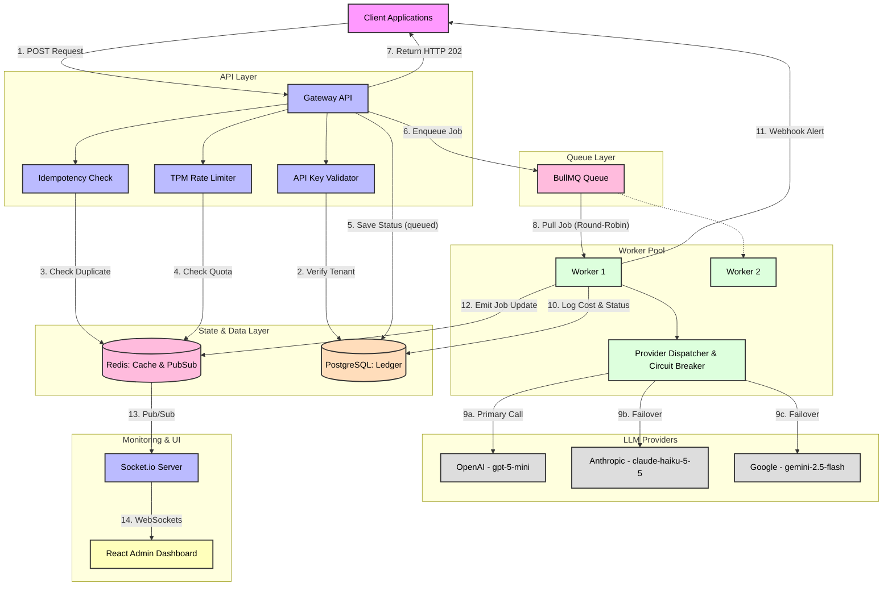

# AI Gateway — Enterprise LLM Traffic Management

> A production-grade, centralized AI Gateway that solves the **Wix-scale problem**: rate limiting, multi-vendor failover, asynchronous processing, and real-time monitoring.

  

---

## 🏗️ Architecture Overview


- **API server** (stateless): authenticates the tenant, deduplicates retries, enforces the sliding-window
  TPM/RPM limit, writes the request row, pushes the job into the tenant's lane, and returns `202 Accepted`.
- **Workers** (scale out): the fair scheduler takes one job per tenant per turn into a short BullMQ buffer;
  the dispatcher calls vendors in priority order, skipping any whose circuit breaker is open.
- **Redis** holds every piece of shared state, so any number of API and worker replicas agree on limits,
  lanes and vendor health. **PostgreSQL** is the source of truth and the billing audit trail.

### Detailed Flow Architecture



---

## 🚀 Quick Start

### Prerequisites
- Node.js 20+
- Docker & Docker Compose
- (Optional) k6 for load testing

### Development Setup

```bash
# 1. Create .env files (root + packages/server)
node scripts/setup.js

# 2. Set JWT_SECRET, and DEMO_MODE=true to enable the Demo Control page.
#    Vendor keys are optional: with LLM_MOCK_MODE=auto (default) each vendor
#    whose key is missing is simulated, so the full pipeline still runs.
#    Put the same values in packages/server/.env (the server reads its own cwd).

# 3. Start Redis + PostgreSQL (schema + seed data load on first start)
docker compose up -d redis postgres

# 4. Install dependencies and run API + worker + dashboard
npm install
npm run dev

# 5. (Optional) 24h of request history for the charts
npm run seed:demo --workspace=packages/server
```

Open [http://localhost:3000](http://localhost:3000) — Login: `admin@gateway.local` / `admin123`.
Then open **Demo Control** — see [DEMO.md](DEMO.md) for a 5-minute walkthrough.

### Full Docker Deployment

```bash
docker compose up -d --build
```

Dashboard on :3000, API on :3001, two worker replicas.

### Tests

```bash
docker compose up -d redis                  # Lua-script tests run against real Redis (DB 15)
npm test --workspace=packages/server        # Jest: limiter, fair queue, breaker, SSRF, idempotency
```

---

## 📡 API Reference

### Submit a Request (Async)

```http
POST /api/v1/gateway/completions
X-Api-Key: your-tenant-api-key
Idempotency-Key: unique-request-id-123
Content-Type: application/json

{
  "userMessage": "Explain quantum computing",
  "systemPrompt": "You are a helpful assistant.",
  "requestedModel": "claude-sonnet-5-5",
  "maxTokens": 512,
  "priority": 5,
  "callbackUrl": "https://your-app.com/webhook"
}
```

**Response: HTTP 202 Accepted**
```json
{
  "requestId": "uuid-v4",
  "jobId": "bullmq-job-id",
  "status": "queued",
  "statusUrl": "/api/v1/gateway/requests/uuid-v4"
}
```

`Idempotency-Key`, `requestedModel`, `systemPrompt` and `callbackUrl` are optional. Without
`requestedModel` each provider uses its default model. `priority` (1 = most urgent … 10) orders
jobs *within* the tenant's lane.

**Rate limited: HTTP 429** with `Retry-After`, `code` = `TPM_EXCEEDED` or `RPM_EXCEEDED`.
Every response carries `X-RateLimit-{Limit,Remaining}-{Tokens,Requests}` headers.

### How the core mechanisms work

| Mechanism | Implementation |
|-----------|----------------|
| **Sliding-window limits** | Per tenant, two Redis hashes of 1-second buckets (tokens, requests). One Lua script sums the last 60s, checks TPM *and* RPM, and admits — atomic across API replicas, no fixed-window boundary burst, rejected requests aren't counted. Tokens are reserved up front (prompt/4 + maxTokens) and reconciled to actual usage when the job completes. |
| **Fair-share round-robin** | Each tenant has its own lane (Redis ZSET, ordered by priority then arrival). A ring of active tenants is rotated by a Lua script that pops one job from the next tenant's lane. The scheduler keeps BullMQ's wait list to a small buffer, so ordering is decided by the round-robin, not arrival time. Can be switched to plain FIFO at runtime for comparison. |
| **Circuit breaker** | Per provider, state in a Redis hash shared by all workers. CLOSED → OPEN after 3 consecutive failures; OPEN → HALF-OPEN after a 10s cooldown; HALF-OPEN admits a capped number of probes; 2 successes close it, any failure reopens it. Each transition is one Lua script. |
| **Failover** | Providers are tried in priority order, one model per provider (requested model, else the provider's default). Breaker-OPEN providers are skipped. `providers_tried` is recorded on every request. |
| **Chaos injection** | `PUT /api/v1/admin/chaos/:provider {"failureRate": 0..1}` makes that vendor fail with a simulated 503 for every worker, to demonstrate failover and the breaker on demand. |

### Poll Status

```http
GET /api/v1/gateway/requests/{requestId}
X-Api-Key: your-tenant-api-key
```

### Dashboard Login

```http
POST /api/v1/admin/auth/login
{ "email": "admin@gateway.local", "password": "admin123" }
```

---

## 🛡️ Security Architecture

| Threat | Mitigation |
|--------|-----------|
| **SSRF** | Callback URLs are DNS-resolved; every resolved IP is checked against private, loopback, link-local/metadata and IPv4-mapped IPv6 ranges; the connection is pinned to the validated IP (with TLS SNI); redirects are refused |
| **Rate Exhaustion** | Per-tenant sliding-window TPM + RPM limiter (atomic Lua); 429 with `Retry-After` |
| **Noisy Neighbor** | Per-tenant fair-share lanes, round-robin scheduling into the worker queue |
| **Replay / duplicates** | `Idempotency-Key` header, tenant-scoped, atomic `SET NX`; concurrent duplicates get 409, completed ones replay the cached response |
| **Key theft from DB** | API keys stored only as SHA-256 hashes (+ display prefix); raw key shown once at creation |
| **Auth Bypass** | API keys for the gateway; JWT + RBAC (admin/operator/viewer) for admin API and WebSocket |

---

## 🔧 Tech Stack

| Layer | Technology | Why |
|-------|-----------|-----|
| **API** | Node.js + Express | Non-blocking I/O for concurrent ingestion |
| **Queue** | BullMQ + Redis | Atomic job management, group-key fair-share |
| **Cache/PubSub** | Redis | Idempotency, TPM limiting, real-time events |
| **Database** | PostgreSQL | ACID audit ledger, routing policies |
| **Real-time** | Socket.io | WebSocket push to dashboard |
| **UI** | React + Recharts | Live "Flight Radar" monitoring |
| **Load Test** | k6 | Scripted concurrency benchmarks |
| **Deploy** | Docker Compose | Reproducible environments |

---

## 📊 Load Testing

```bash
# Install k6: https://k6.io/docs/getting-started/installation/

# Run with default config (local)
npm run test:load

# Custom target
k6 run --env GATEWAY_URL=http://localhost:3001 \
        --env API_KEY=demo-api-key \
        packages/server/tests/load/gateway-load-test.js
```

**Test phases:**
1. Ramp: 0→10 VUs over 30s
2. Sustained: 50 VUs for 1 min
3. Spike: 200 VUs — triggers rate limiting
4. Cool down

---

## 🔴 Known Limitations & Roadmap

| Issue | Planned Fix |
|-------|------------|
| Postgres metric writes at scale | Migrate hot metrics to ClickHouse/InfluxDB append-only |
| Single Redis instance; fair-share Lua scripts build keys dynamically (not Redis Cluster-safe) | Redis Sentinel; hash-tag lane keys for Cluster |
| A job popped from a lane is lost if the scheduler crashes before handing it to BullMQ (request row stays `queued`) | Move lane → BullMQ inside one Lua script, or a reaper for stale `queued` rows |
| Token ledger is batched in memory (500ms) before insert | Write-ahead to a Redis stream for durability |
| Token reservation estimate is chars/4 | Use the vendor tokenizer |
| No streaming responses | SSE endpoint for chat use-cases |
| No prompt caching | Semantic cache (Redis + embeddings) for identical prompts |

---

## 📁 Project Structure

```
ai-gateway/
├── packages/
│   ├── server/              # Node.js API + BullMQ workers
│   │   ├── src/
│   │   │   ├── db/          # PostgreSQL pool + Redis client
│   │   │   ├── demo/        # Traffic generator, history seeder
│   │   │   ├── middleware/  # Auth, idempotency, rate limiting
│   │   │   ├── providers/   # Vendor classes + failover dispatcher
│   │   │   ├── queue/       # Fair-share lanes, BullMQ queue + worker
│   │   │   ├── routes/      # Express routes
│   │   │   ├── services/    # Live control-plane snapshot
│   │   │   ├── socket/      # Socket.io server
│   │   │   ├── utils/       # Limiter, circuit breaker, chaos, SSRF, API keys
│   │   │   ├── index.ts     # API server entry
│   │   │   └── worker.ts    # Worker entry
│   │   └── tests/           # Jest unit tests + k6 load tests
│   └── dashboard/           # React admin dashboard
│       └── src/
│           ├── api/         # Axios client
│           ├── components/  # Layout
│           ├── contexts/    # Auth + Socket contexts
│           └── pages/       # Dashboard, Requests, Providers, Tenants, Playground, Demo
├── docker-compose.yml
├── .env.example
└── scripts/setup.js
```


---

## 👤 Author

**Yash Sharma** — [GitHub](https://github.com/Yash2004Codes)
