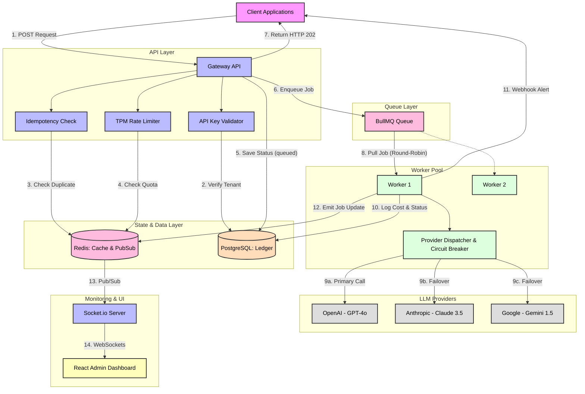

# AI Gateway — Enterprise LLM Traffic Management

> A production-grade, centralized AI Gateway that solves the **Wix-scale problem**: rate limiting, multi-vendor failover, asynchronous processing, and real-time monitoring.

  

---

## 🏗️ Architecture Overview

```
┌─────────────────────────────────────────────────────────────────────┐
│                         Client Applications                         │
└────────────────────────────┬────────────────────────────────────────┘
                             │  POST /api/v1/gateway/completions
                             │  X-Api-Key: <tenant-api-key>
                             ▼
┌─────────────────────────────────────────────────────────────────────┐
│              Express API Server (Node.js + Socket.io)               │
│                                                                     │
│  1. Authenticate tenant via API key → PostgreSQL                    │
│  2. Check idempotency key → Redis (prevent duplicates)              │
│  3. Pre-flight TPM check → Redis sliding window                     │
│  4. Persist request → PostgreSQL gateway_requests                   │
│  5. Enqueue job with TENANT GROUP KEY → BullMQ                      │
│  6. Return HTTP 202 Accepted immediately                            │
└────────────────────────────┬────────────────────────────────────────┘
                             │
                      BullMQ Queue (Redis)
                      [Fair-share: round-robin by tenant group key]
                             │
                  ┌──────────┴──────────┐
                  ▼                     ▼
          ┌──────────────┐    ┌──────────────────┐
          │   Worker 1   │    │    Worker 2       │
          │  (BullMQ)    │    │   (BullMQ)        │
          └──────┬───────┘    └────────┬──────────┘
                 │                     │
                 ▼                     ▼
         ┌───────────────────────────────────────┐
         │         Provider Dispatcher            │
         │  Priority → OpenAI → Anthropic → Gemini│
         │  Auto-failover on 429/5xx              │
         │  SSRF protection on callbacks          │
         └──────────────────┬────────────────────┘
                            │
              ┌─────────────┼─────────────┐
              ▼             ▼             ▼
          OpenAI       Anthropic       Gemini
          GPT-4o       Claude-3.5   Gemini-1.5-Pro

                            │ Results
                            ▼
         ┌──────────────────────────────────────┐
         │   PostgreSQL                          │
         │   - gateway_requests (status update)  │
         │   - token_usage_ledger (billing audit)│
         │   - provider_health_events            │
         └──────────────────────────────────────┘
                            │
                     Redis Pub/Sub
                            │
                            ▼
         ┌──────────────────────────────────────┐
         │   Socket.io → React Dashboard        │
         │   Live provider health, queue depth,  │
         │   failover events, cost tracking      │
         └──────────────────────────────────────┘
```

### Detailed Flow Architecture



---

## 🚀 Quick Start

### Prerequisites
- Node.js 20+
- Docker & Docker Compose
- (Optional) k6 for load testing

### Development Setup

```bash
# 1. Clone and setup
cd ai-gateway
node scripts/setup.js

# 2. Edit .env with your API keys
# OPENAI_API_KEY, ANTHROPIC_API_KEY, GEMINI_API_KEY
# No keys yet? Set LLM_MOCK_MODE=true to simulate vendor responses
# (LLM_MOCK_FAILURE_RATE=0.3 exercises failover + circuit breaker)
# Set the same values in packages/server/.env (the server reads its own cwd)

# 3. Start Redis + PostgreSQL
docker-compose up -d redis postgres

# 4. Install all dependencies
npm install

# 5. Run everything in development
npm run dev
```

Open [http://localhost:3000](http://localhost:3000) — Login: `admin@gateway.local` / `admin123`

### Full Docker Deployment

```bash
docker-compose up -d
```

---

## 📡 API Reference

### Submit a Request (Async)

```http
POST /api/v1/gateway/completions
X-Api-Key: your-tenant-api-key
Content-Type: application/json

{
  "userMessage": "Explain quantum computing",
  "systemPrompt": "You are a helpful assistant.",
  "maxTokens": 512,
  "priority": 5,
  "idempotencyKey": "unique-request-id-123",
  "callbackUrl": "https://your-app.com/webhook"
}
```

**Response: HTTP 202 Accepted**
```json
{
  "requestId": "uuid-v4",
  "jobId": "bullmq-job-id",
  "status": "queued",
  "statusUrl": "/api/v1/gateway/requests/uuid-v4"
}
```

### Poll Status

```http
GET /api/v1/gateway/requests/{requestId}
X-Api-Key: your-tenant-api-key
```

### Dashboard Login

```http
POST /api/v1/admin/auth/login
{ "email": "admin@gateway.local", "password": "admin123" }
```

---

## 🛡️ Security Architecture

| Threat | Mitigation |
|--------|-----------|
| **SSRF** | Callback URLs validated against allowlist of public domains; internal IPs/RFC-1918 blocked |
| **Rate Exhaustion** | Per-tenant Redis sliding window TPM limiter; returns 429 with `Retry-After` |
| **Noisy Neighbor** | BullMQ group keys per tenant enforce fair round-robin processing |
| **Replay Attacks** | Redis idempotency cache (24h TTL) deduplicates identical requests |
| **Auth Bypass** | API key + JWT with role-based access control (admin/operator/viewer) |

---

## 🔧 Tech Stack

| Layer | Technology | Why |
|-------|-----------|-----|
| **API** | Node.js + Express | Non-blocking I/O for concurrent ingestion |
| **Queue** | BullMQ + Redis | Atomic job management, group-key fair-share |
| **Cache/PubSub** | Redis | Idempotency, TPM limiting, real-time events |
| **Database** | PostgreSQL | ACID audit ledger, routing policies |
| **Real-time** | Socket.io | WebSocket push to dashboard |
| **UI** | React + Recharts | Live "Flight Radar" monitoring |
| **Load Test** | k6 | Scripted concurrency benchmarks |
| **Deploy** | Docker Compose | Reproducible environments |

---

## 📊 Load Testing

```bash
# Install k6: https://k6.io/docs/getting-started/installation/

# Run with default config (local)
npm run test:load

# Custom target
k6 run --env GATEWAY_URL=http://localhost:3001 \
        --env API_KEY=demo-api-key \
        packages/server/tests/load/gateway-load-test.js
```

**Test phases:**
1. Ramp: 0→10 VUs over 30s
2. Sustained: 50 VUs for 1 min
3. Spike: 200 VUs — triggers rate limiting
4. Cool down

---

## 🔴 Known Limitations & Roadmap

| Issue | Planned Fix |
|-------|------------|
| Postgres metric writes at scale | Migrate hot metrics to ClickHouse/InfluxDB append-only |
| Single Redis instance | Redis Sentinel/Cluster for HA |
| No prompt caching | Semantic cache (Redis + embeddings) for identical prompts |
| Manual health checks | Active health probes with circuit breaker pattern |

---

## 📁 Project Structure

```
ai-gateway/
├── packages/
│   ├── server/              # Node.js API + BullMQ workers
│   │   ├── src/
│   │   │   ├── db/          # PostgreSQL pool + Redis client
│   │   │   ├── middleware/  # Auth, rate limiting
│   │   │   ├── providers/   # OpenAI/Anthropic/Gemini adapters
│   │   │   ├── queue/       # BullMQ queue + worker
│   │   │   ├── routes/      # Express routes
│   │   │   ├── socket/      # Socket.io server
│   │   │   ├── utils/       # Logger
│   │   │   ├── index.ts     # API server entry
│   │   │   └── worker.ts    # Worker entry
│   │   └── tests/load/      # k6 load tests
│   └── dashboard/           # React admin dashboard
│       └── src/
│           ├── api/         # Axios client
│           ├── components/  # Layout
│           ├── contexts/    # Auth + Socket contexts
│           └── pages/       # Dashboard, Requests, Providers, Tenants, Playground
├── docker-compose.yml
├── .env.example
└── scripts/setup.js
```
