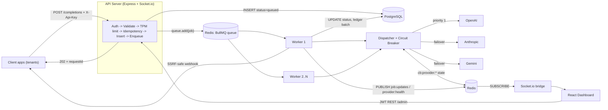
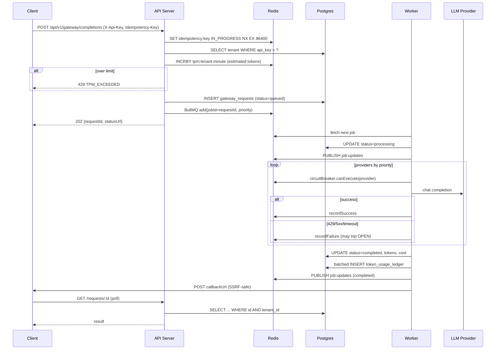
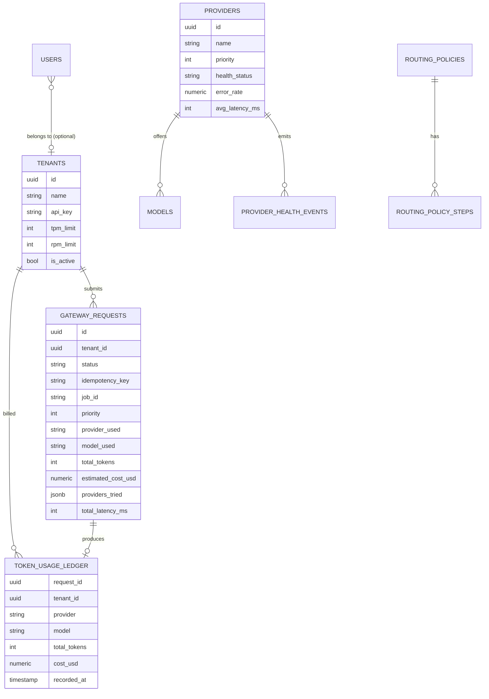

# AI Gateway — CTO Interview Prep

> Read top-to-bottom once. Before the interview, re-read **§1 (pitch)**, **§5 (request lifecycle)**, **§9 (trade-offs)** and **§12 (Q&A)**.

---

## 0. Cheat Sheet (memorise this)

| Item | One-liner |
|---|---|
| **What** | A centralized, multi-tenant proxy that sits between internal apps and LLM vendors (OpenAI, Anthropic, Gemini). |
| **Why** | Every team calling LLMs directly → rate-limit storms (429s), vendor outages break products, no cost visibility, leaked keys. |
| **How** | Accept fast (HTTP 202) → queue (BullMQ/Redis) → workers dispatch with **failover + circuit breaker** → persist to Postgres → push live updates via Socket.io. |
| **Stack** | Node.js/TypeScript, Express, BullMQ, Redis, PostgreSQL, Socket.io, React + Recharts, Docker Compose, k6. |
| **Key patterns** | Async request-reply, queue-based load leveling, circuit breaker, idempotency keys, token-bucket-ish TPM limiting, write batching, SSRF-safe webhooks with DNS pinning. |
| **Honest gaps** | Fair-share is designed but not truly enforced (needs BullMQ Pro groups or custom scheduler); fixed-window not sliding-window limiter; circuit breaker not atomic (needs Lua); in-memory ledger batch can lose data on crash. |

---

## 1. Elevator Pitch

### 30 seconds
> "I built an **enterprise AI Gateway** — a single entry point for all LLM traffic in a company. Instead of each team calling OpenAI directly, they call the gateway with a tenant API key. The gateway **authenticates, rate-limits per tenant by tokens-per-minute, deduplicates with idempotency keys, and enqueues** the job, returning 202 immediately. Workers pull jobs and dispatch to providers in priority order with **automatic failover and a Redis-backed circuit breaker**. Every call is recorded in a **token ledger for cost attribution**, and a **React dashboard** shows provider health, queue depth and failovers in real time over WebSockets."

### 2 minutes (add these)
- **Async by design**: LLM calls take 2–30s. Holding HTTP connections open at scale exhausts sockets/threads. So: 202 Accepted + poll or webhook callback.
- **Resilience**: provider chain OpenAI → Anthropic → Gemini. Circuit breaker state lives in Redis so *all workers share it* — one worker discovering OpenAI is down protects every other worker.
- **Multi-tenancy**: per-tenant TPM limits in Redis; tenant-scoped data in Postgres; per-tenant cost ledger.
- **Security**: API keys for machines, JWT + RBAC for humans, SSRF protection on callback URLs (DNS resolve → block private ranges → pin IP → no redirects).
- **Horizontally scalable**: API and workers are stateless; scale workers independently (compose runs 2 replicas).

---

## 2. Problem Statement (PS)

### Context — "the Wix-scale problem"
A company with many product teams (hundreds of features) starts embedding LLMs everywhere: site builders, chatbots, content generation, support summaries.

### Pain points without a gateway
| # | Problem | Business impact |
|---|---|---|
| 1 | **Vendor rate limits** (TPM/RPM per org key) are shared by all teams | One team's batch job causes 429s for the customer-facing chatbot |
| 2 | **Noisy neighbour** | A single tenant floods the system, everyone's latency spikes |
| 3 | **Vendor outages** (OpenAI has had multi-hour incidents) | Features hard-coded to one vendor go down entirely |
| 4 | **Synchronous long calls** | 10–30s requests hold connections; threads/sockets exhausted under load |
| 5 | **No cost visibility** | Finance can't attribute a $200k/month bill to teams |
| 6 | **Duplicate requests** (client retries, double-clicks) | Paying twice for the same tokens |
| 7 | **Key sprawl** | Vendor API keys copied into dozens of services → leak risk |
| 8 | **No observability** | Nobody knows which provider is degraded right now |

### Problem statement (one sentence)
> *Design a centralized, multi-tenant gateway that lets many internal consumers use multiple LLM vendors **reliably, fairly, securely and cost-transparently**, without each consumer re-implementing retries, failover, rate limiting and accounting.*

### Requirements

**Functional**
- Submit completion request (system prompt, user message, model preference, max tokens, priority).
- Get result by polling or via webhook callback.
- Multi-provider support with automatic failover.
- Per-tenant API keys and TPM limits.
- Idempotent submission.
- Admin dashboard: live health, queue depth, requests, tenants, playground.
- Cost / token accounting per tenant.

**Non-functional**
- Ingestion latency low (target p95 < ~100–350ms for the 202 response, independent of LLM latency).
- High availability: survive single-vendor outage.
- Horizontal scalability of API and workers independently.
- Auditability (immutable-ish token ledger).
- Security: tenant isolation, SSRF protection, RBAC.

**Out of scope (v1)**
- Streaming (SSE) responses, semantic caching, prompt/PII filtering, per-request model routing policies beyond priority.

---

## 3. Solution Overview

**Core idea:** decouple *accepting* a request from *executing* it.

1. **Edge (API server)** does only cheap, fast work: auth, validation, rate limit, idempotency, DB insert, enqueue → **202**.
2. **Queue (BullMQ on Redis)** absorbs bursts (load leveling), provides retries with exponential backoff, priorities, stalled-job recovery.
3. **Workers** do slow work: call LLMs with failover + circuit breaker, write results, ledger, publish events, fire webhook.
4. **Postgres** = source of truth (requests, tenants, providers, models, ledger, health events).
5. **Redis** = fast shared state (queue, rate-limit counters, idempotency keys, circuit-breaker state, pub/sub).
6. **Socket.io + React** = live "flight radar" dashboard.

---

## 4. Architecture

### 4.1 High-level diagram



### 4.2 Deployment (docker-compose)
| Service | Image | Notes |
|---|---|---|
| `redis` | redis:7.2-alpine | AOF persistence (`appendonly yes`), `maxmemory 512mb`, `allkeys-lru` |
| `postgres` | postgres:16-alpine | `init.sql` auto-runs schema + seed |
| `api-server` | Node 20 multi-stage | port 3001, waits for healthy redis/postgres |
| `worker` | same image, `node dist/worker.js` | **2 replicas** → horizontal scaling demo |
| `dashboard` | Vite build → nginx | nginx proxies `/api` and `/socket.io` to api-server (same origin → no CORS pain) |

> Talking point on `allkeys-lru`: good for cache, **risky for a queue** — LRU could evict BullMQ keys. In production I'd use `noeviction` for the queue Redis and a separate Redis for caching. (Shows depth — say it proactively.)

### 4.3 Code map
```
packages/server/src
├── index.ts                     API entry, health check, graceful shutdown
├── worker.ts                    Worker entry (separately scalable process)
├── routes/gateway.routes.ts     POST /completions, GET /requests/:id, GET /requests
├── routes/admin.routes.ts       JWT login, metrics, tenants, providers, CB reset
├── middleware/auth.middleware.ts   apiKeyAuth, jwtAuth, requireRole (RBAC)
├── middleware/ratelimit.middleware.ts  TPM pre-flight limiter + validation
├── middleware/idempotency.middleware.ts  SET NX "IN_PROGRESS" lock + cached replay
├── queue/gateway.queue.ts       BullMQ queue, retries, backoff, metrics
├── queue/gateway.worker.ts      Job processor (dispatch → DB → ledger → pubsub → webhook)
├── providers/dispatcher.ts      OpenAI / Anthropic / Gemini adapters + failover loop
├── utils/redisCircuitBreaker.ts Distributed CLOSED/OPEN/HALF_OPEN state machine
├── utils/ssrfSafeWebhook.ts     DNS resolve, CIDR blocklist, IP pinning, no redirects
├── db/batchLogger.ts            Batched multi-row INSERT for token ledger
├── db/redis.ts, db/pool.ts      Clients, TPM counter, pub/sub helpers
└── socket/socket.server.ts      Redis pub/sub → Socket.io bridge, 5s metrics push
packages/dashboard/src           React pages: Dashboard, Requests, Providers, Tenants, Playground, Login
```

---

## 5. Request Lifecycle (walk through this on a whiteboard)



**Key detail to mention:** `jobId = requestId` → BullMQ itself dedupes a second `add` with the same ID, a second layer of idempotency.

---

## 6. Component Deep Dives

### 6.1 Ingestion & 202 pattern
- Why 202: LLM latency is unbounded (2–60s). Synchronous proxying ties up a socket per request; at 5k concurrent requests you hit file-descriptor / LB idle-timeout limits.
- Client gets `statusUrl` to poll **or** provides `callbackUrl` for push.
- Trade-off: more complex for clients than a simple sync call. Mitigation: provide an SDK, or add a sync mode with timeout for small requests, or SSE streaming.

### 6.2 Authentication & RBAC
- **Machines**: `X-Api-Key` → lookup `tenants.api_key` → attach `req.tenant`.
- **Humans**: JWT (`/admin/auth/login`, bcrypt passwords) → `requireRole('admin'|'operator'|'viewer')`.
- Improvement: **store API keys hashed** (SHA-256) with a prefix for lookup, like Stripe (`sk_live_abc…`). Currently plaintext. Also cache tenant lookup in Redis to avoid a DB hit per request.

### 6.3 Rate limiting (TPM)
- Pre-flight estimate: `ceil((len(userMessage)+len(systemPrompt))/4) + maxTokens` (4 chars ≈ 1 token heuristic; worst-case because completion could use all `maxTokens`).
- Redis `INCRBY tpm:{tenant}:{minuteBucket}` + `EXPIRE 120` in a pipeline → atomic counter, O(1).
- Returns `X-RateLimit-Limit/Remaining/Reset` headers and **429** with `retryAfter`.
- **Honest assessment:** this is a **fixed window**, not sliding — allows up to 2× burst at the minute boundary. Also counts rejected requests against the budget and never reconciles estimate vs actual usage.
- **Better:** sliding-window log/counter or **token bucket in a Lua script** (atomic check-and-decrement), then *reconcile* with actual usage after completion (refund unused tokens).

### 6.4 Idempotency
- `Idempotency-Key` header → `SET key IN_PROGRESS NX EX 86400`.
  - Not acquired + `IN_PROGRESS` → **409 Conflict** (concurrent duplicate).
  - Not acquired + cached response → replay same status/body.
- Plus BullMQ `jobId=requestId`, plus partial unique index on `gateway_requests.idempotency_key`.
- **Gap:** middleware runs *before* auth, so key scope falls back to `global` → two tenants using the same key would collide. Fix: run after `apiKeyAuth`, key = `idempotency:{tenantId}:{key}`. Also there's a second body-field mechanism → consolidate to one.

### 6.5 Queue (BullMQ)
- Why BullMQ: Redis-backed, atomic Lua-based state transitions, retries with exponential backoff, priorities, delayed jobs, stalled-job detection, concurrency per worker, good Node ecosystem.
- Config: `attempts=3`, exponential backoff from 1s, `removeOnComplete {count:100, age:1h}`, `removeOnFail {count:200, age:24h}`, worker `concurrency=5`, `stalledInterval=60s`, `maxStalledCount=2`.
- Priorities 1–10 (BullMQ: lower number = higher priority).
- **Delivery semantics: at-least-once.** A worker could crash after calling the LLM but before acking → job reruns → double cost. Mitigations: check `gateway_requests.status` at job start and skip if already `completed`; ledger keyed unique on `request_id`.

**Alternatives considered**
| Option | Why not (for v1) |
|---|---|
| Kafka | Great throughput/replay, but no per-message retry/delay/priority; heavy ops |
| RabbitMQ | Solid, but extra infra; Redis already needed for limits/cache |
| SQS | Cloud lock-in; fine choice on AWS |
| Postgres `SKIP LOCKED` | Simple, but adds write load to the primary DB |

### 6.6 Fair share / noisy neighbour
- **Intent:** round-robin across tenants so one tenant can't starve others.
- **Reality (be honest if asked):** `tenantGroupKey` is put into job data but **not passed to BullMQ**; group-based rate limiting is a **BullMQ Pro** feature. So today noisy-neighbour protection comes from the **per-tenant TPM limiter at ingestion**, not the queue.
- **How I'd finish it:**
  1. BullMQ Pro groups (`group: { id: tenantId }`) — simplest, paid.
  2. **One queue per tenant (or per tier)** + a scheduler that round-robins / weighted-fair-queues across them.
  3. Per-tenant concurrency caps via Redis semaphores in the worker.
- There's a k6 `noisy-neighbor-test.js`: 15 VUs spam as one tenant, a quiet tenant sends 2 rps; threshold: quiet tenant p95 < 350ms on ingestion.

### 6.7 Provider dispatcher & failover
- Loads active `providers ⨝ models` ordered by `priority ASC, avg_latency_ms ASC`.
- If client requested a model, that provider's entry moves to the front.
- For each candidate: skip if circuit OPEN or `health_status = 'down'`; call adapter; on success record success + health event; on failure record failure and continue.
- Adapters normalise to one shape: `{provider, model, responseText, prompt/completion/total tokens, latencyMs, costUsd}`.
  - OpenAI SDK, Anthropic SDK, Gemini via REST (axios, 30s timeout). Gemini system prompt emulated as user + "Understood." turn.
- Cost = `tokens/1000 × per-model price` (table in code, also in `models` table).
- Health: rolling 5-minute error rate → `healthy` (<20%), `degraded` (20–50%), `down` (>50%); published on `provider:health`.

**Talking points:**
- 429 vs 5xx should be handled differently: 429 → respect `Retry-After`, maybe don't trip breaker as hard; 400 (bad prompt) should **not** fail over (it'll fail everywhere) and should **not** count toward the breaker.
- Failover changes model → **response quality/format differs**. Need per-tenant policy: "allow cross-vendor failover?" (there's a `routing_policies` table for this direction).
- Per-call timeouts should be set on SDK clients too (OpenAI/Anthropic defaults are long).

### 6.8 Distributed circuit breaker
State in Redis hash `cb:provider:{name}` → shared by all workers.

```
CLOSED --(3 consecutive failures)--> OPEN
OPEN   --(10s cooldown elapsed)----> HALF_OPEN (allow up to 3 probe requests)
HALF_OPEN --(2 successes)----------> CLOSED
HALF_OPEN --(any failure)----------> OPEN (cooldown restarts)
```
- Admin can force-reset via API.
- Why distributed: with N workers, an in-memory breaker needs N×3 failures to learn about an outage; shared state learns once.
- **Gap:** read (`HGETALL`) then write → **race conditions** between workers (e.g., more than 3 probes in HALF_OPEN). Fix: implement transitions in a **Lua script** (atomic) or `WATCH/MULTI`. Also Redis becomes a dependency of the hot path — if Redis is down, decide fail-open vs fail-closed (I'd fail-open to CLOSED).

### 6.9 Persistence & batching
Tables: `tenants`, `users`, `providers`, `models`, `routing_policies`, `routing_policy_steps`, `gateway_requests`, `token_usage_ledger`, `provider_health_events`.
Indexes: `gateway_requests(tenant_id)`, `(status)`, `(created_at DESC)`, partial on `idempotency_key`, `token_usage_ledger(tenant_id, recorded_at DESC)`, `provider_health_events(provider_id, recorded_at DESC)`.

- **BatchLogger**: buffers ledger rows in memory, flushes every **500ms or 100 rows** as one multi-row `INSERT` → ~100× fewer round-trips. Re-queues on failure.
- **Gap:** in-memory → lost on crash (`beforeExit` doesn't fire on SIGKILL/OOM). Fix: write ledger in the same transaction as the status update, or buffer in Redis Streams, or use an outbox table.
- At scale: move hot metrics/health events to ClickHouse/Timescale; partition `gateway_requests` by month; archive `response_text` to object storage.

### 6.10 Real-time dashboard
- Workers `PUBLISH` to `job:updates` and `provider:health`.
- API server subscribes (dedicated ioredis connection — required since a subscribing connection can't run other commands) and re-emits via Socket.io; tenant rooms (`tenant:{id}`) for scoping.
- Every 5s pushes queue metrics + provider health (only if clients connected).
- **Scaling multiple API instances:** each instance subscribes to Redis, so every instance receives every event — works. For sticky sessions with polling transport, use `@socket.io/redis-adapter` + sticky LB.
- **Gap:** socket auth is a stub ("allow all") → must verify JWT on handshake; `io.emit` broadcasts every tenant's events to every client.

### 6.11 SSRF-safe webhooks (strong point — explain clearly)
Attack: tenant sets `callbackUrl = http://169.254.169.254/latest/meta-data/` (cloud metadata) or `http://redis:6379` → gateway makes internal requests on attacker's behalf.

Defence in `ssrfSafeWebhook.ts`:
1. Only `http/https`.
2. **Resolve DNS** for all A/AAAA records.
3. Reject if **any** resolved IP is in blocklist: RFC1918 (10/8, 172.16/12, 192.168/16), loopback, link-local/IMDS 169.254/16, CGNAT 100.64/10, multicast, reserved, IPv6 ULA/link-local, IPv4-mapped IPv6.
4. **DNS pinning**: connect to the validated IP directly (defeats **DNS rebinding** — TOCTOU between check and connect), keep `Host` header and TLS **SNI** = original hostname.
5. **No redirects** (a 302 to an internal IP would bypass checks).
6. Timeout 10s.
Plus unit tests in `tests/unit/ssrfSafeWebhook.test.ts`.

Improvements: HMAC-sign webhook payloads (`X-Signature`) so receivers can verify; retry webhooks with backoff via their own queue; cap response body size.

---

## 7. Data Model (simplified)



Request status machine: `queued → processing → completed | failed`.

---

## 8. Scale & Back-of-Envelope (be ready to compute live)

Assume **1,000 req/s** peak, avg LLM latency **5s**, avg **1,500 tokens/request**.

- **In-flight LLM calls** (Little's Law: L = λ × W) = 1000 × 5 = **5,000 concurrent**.
- Worker concurrency 5 → need ~**1,000 worker slots**; Node is I/O-bound, so raise concurrency to ~100–200 per process → **25–50 worker pods**.
- **Tokens/min** = 1000 × 60 × 1500 = **90M TPM** → far exceeds a single vendor org limit (often 1–30M TPM) → need **multiple keys/accounts per vendor** + spread across vendors. This is *why* the gateway exists.
- **Postgres writes**: per request ≈ 1 insert + 2–3 updates + ledger (batched) → ~4k writes/s → OK for a tuned Postgres, but `UPDATE`-heavy → bloat/vacuum; this is why I'd move metrics to an append-only store.
- **Redis**: per request ≈ 10–20 ops → 20k ops/s → trivial for Redis (100k+ ops/s single node).
- **API tier**: cheap work, ~1–2k rps per Node instance → 2–4 instances behind an LB.
- **Bottleneck order**: vendor TPM limits ≫ Postgres writes > worker concurrency > Redis > API.

---

## 9. Key Design Decisions & Trade-offs

| Decision | Why | Trade-off / what I'd revisit |
|---|---|---|
| Async 202 + queue | Absorb bursts, decouple from LLM latency, retries for free | Client complexity; no streaming |
| BullMQ on Redis | Retries, priority, backoff, stall detection; Redis already needed | Redis becomes critical (needs HA: Sentinel/Cluster, `noeviction`) |
| Postgres as source of truth | ACID, relational tenant/provider config, SQL for billing | Write-heavy at scale → partition / offload metrics |
| Shared circuit breaker in Redis | Whole fleet learns about outages instantly | Hot-path Redis dependency; needs Lua atomicity |
| Pre-flight token estimate | Reject before spending money | Over-estimates (uses maxTokens); needs reconciliation |
| Batch ledger writes | ~100× fewer DB round-trips | Durability risk on crash |
| Separate worker process | Scale independently; API stays responsive | More deployables |
| Monorepo (npm workspaces) | Shared tooling, atomic changes | Shared types package not yet extracted |
| Socket.io via Redis pub/sub | Workers don't need to know about websockets | Pub/sub is fire-and-forget (missed events if API restarts) — fine for dashboards |
| nginx same-origin proxy | No CORS, single entry for UI | — |

---

## 10. Failure Modes — "What happens if…?"

| Failure | Behaviour | Improvement |
|---|---|---|
| OpenAI down | 3 failures → breaker OPEN → traffic flows to Anthropic/Gemini; probes after 10s | Per-error-class handling; alerting |
| All providers down | Job marked `failed`, BullMQ retries 3× with backoff | Don't mark `failed` until final attempt; DLQ + alert |
| Worker crashes mid-job | Lock expires → stalled → re-queued (at-least-once) | Idempotent processing (skip if completed) |
| Redis down | Ingestion fails (queue/limits); health returns 503 | Redis Sentinel/Cluster; fail-open limiter |
| Postgres down | Auth & inserts fail → 5xx | Read replica for auth, tenant cache in Redis, PgBouncer |
| Traffic spike | Queue grows; 202s still fast; TPM limiter sheds per-tenant load | Autoscale workers on queue depth (KEDA) |
| Malicious callback URL | Blocked by SSRF guard | HMAC signatures |
| Duplicate submit | 409 (in-progress) or cached replay | Tenant-scoped keys |

---

## 11. Security Summary

| Threat | Mitigation in project | Next step |
|---|---|---|
| SSRF | DNS resolve + CIDR blocklist + IP pinning + SNI + no redirects | Egress proxy / network policy as defence-in-depth |
| Rate exhaustion | Per-tenant TPM limiter, 429 + headers | Global limiter per vendor key |
| Noisy neighbour | TPM limiter (queue fairness planned) | Per-tenant queues / weighted fair queuing |
| Replay / duplicates | Idempotency keys (Redis NX) + jobId dedupe | Tenant-scoped keys |
| Auth bypass | API keys, JWT, RBAC (admin/operator/viewer) | Hash API keys, key rotation, short-lived JWT + refresh |
| Vendor key leakage | Keys only in gateway env | Secrets manager (Vault/KMS), per-tenant BYO keys |
| Web hardening | helmet, CORS allowlist, 10MB body limit, input length cap 100k chars | zod schema validation (dep present), prompt-injection/PII filters |

---

## 12. Likely CTO Questions & Model Answers

**Q1. Why not just let teams call OpenAI directly with retries?**
Shared org-level rate limits, no failover, no cost attribution, keys everywhere, every team re-implements the same logic badly. Gateway = one place for policy, security, observability. Same reason companies have API gateways.

**Q2. Why async instead of a simple reverse proxy?**
LLM calls are long and bursty. Sync proxy → connection exhaustion, LB timeouts, and no place to buffer when vendors throttle. Queue gives load leveling, retries, prioritisation. I'd add a sync/streaming mode for interactive chat use-cases.

**Q3. How do you guarantee a request isn't processed twice?**
Three layers: Redis `SET NX` idempotency key at ingestion; BullMQ `jobId=requestId` dedupe; DB unique index. Processing is still at-least-once (worker crash after LLM call), so I'd make the worker check `status` before dispatching and make ledger inserts unique on `request_id`. Exactly-once end-to-end isn't achievable with external side effects — you design for idempotent effects.

**Q4. How does the circuit breaker work and why in Redis?**
(Explain state machine §6.8.) In Redis so all workers share state. Known issue: read-modify-write race → move to Lua script.

**Q5. How do you handle the noisy-neighbour problem?**
Today: per-tenant TPM limit at the edge. Queue-level fairness was designed via group keys but BullMQ OSS doesn't do group round-robin — that's BullMQ Pro. Next step: per-tenant queues + weighted fair scheduler, or per-tenant concurrency semaphore. *(Being upfront here earns trust.)*

**Q6. Your rate limiter — sliding window?**
It's actually a fixed-window counter per minute (INCRBY + EXPIRE), which allows boundary bursts. I'd move to a Lua token bucket or sliding-window counter (weighted current + previous window), and refund the difference between estimated and actual tokens after completion.

**Q7. How would you scale to 10× traffic?**
Stateless API + workers → horizontal scaling; autoscale workers on queue depth; Redis Cluster (queues are hash-tagged in BullMQ); Postgres: PgBouncer, partition `gateway_requests` by time, move metrics to ClickHouse; multiple vendor API keys with a key pool and per-key limiter. Real bottleneck is vendor TPM, not our infra (§8).

**Q8. How do you track cost?**
Each completion writes a ledger row (tokens + cost from per-model price table). Batch inserted. Aggregate by tenant/day for chargeback. Prices are in `models` table so they can be updated without deploy. Improvement: use vendor-reported usage (already used) and reconcile with vendor invoices monthly.

**Q9. Failover changes the model — isn't that a problem?**
Yes — quality, formatting, context window and tool-calling differ. Needs per-tenant routing policy: allowed providers, equivalent model mapping (gpt-4o ↔ claude-3.5-sonnet ↔ gemini-1.5-pro), and "fail rather than downgrade" option. Schema already has `routing_policies` / `routing_policy_steps` for this.

**Q10. What happens if Redis goes down?**
Queue, limits, idempotency and breaker are unavailable → ingestion fails; `/health` returns 503 so LB drains. Production: Redis Sentinel or managed (ElastiCache) with Multi-AZ, AOF on, `noeviction` for the queue instance, and fail-open policy for the limiter/breaker.

**Q11. How did you test it?**
Unit tests for the circuit breaker, idempotency middleware and SSRF guard; k6 load tests: ramp → sustained 50 VUs → spike 200 VUs (to trigger 429s), and a noisy-neighbour scenario asserting quiet-tenant p95 < 350ms. Next: integration tests with Testcontainers (real Redis/Postgres) and a mock LLM server to simulate 429/500/timeouts for failover tests.
> ⚠️ Don't quote specific benchmark numbers you haven't measured. Say "the test is designed to assert…".

**Q12. Observability?**
Winston structured logs, request logs via morgan, provider health events table, live dashboard. Next: OpenTelemetry traces (API → queue → worker → vendor, propagate `requestId`), Prometheus metrics (queue depth, p95 per provider, breaker state), alerts on breaker OPEN and queue lag.

**Q13. Why Node.js?**
Workload is I/O-bound (waiting on HTTP), Node's event loop handles thousands of concurrent outbound calls cheaply; first-class SDKs for all vendors; same language as the React dashboard (shared types). For CPU-heavy work (tokenisation, embeddings) I'd use worker threads or a separate service.

**Q14. Why Postgres over Mongo?**
Relational config (tenants ↔ policies ↔ providers ↔ models), transactional status updates, SQL aggregations for billing. JSONB available for semi-structured fields (`providers_tried`).

**Q15. What would you add next? (prioritised)**
1. Fix correctness: Lua-atomic breaker + limiter, tenant-scoped idempotency, durable ledger, socket JWT auth, hashed API keys.
2. Real fair queuing per tenant.
3. Streaming (SSE) for chat use-cases.
4. Semantic cache (embeddings + Redis vector) for repeated prompts → cost savings.
5. OpenTelemetry + Prometheus/Grafana; autoscaling on queue depth.
6. PII redaction / prompt-injection guardrails; per-tenant budgets ($ caps, not just TPM).

**Q16. What was the hardest part?**
Pick one and tell a story: *SSRF protection* — naive URL-string checks are bypassable via DNS rebinding, redirects, decimal/IPv6-mapped IPs; solution was resolve → validate every IP → pin IP while keeping SNI → refuse redirects. Or *distributed circuit breaker* — reasoning about shared state across workers.

**Q17. What would you do differently?**
Be honest: build integration tests and run load tests earlier; implement fairness with per-tenant queues from day one instead of relying on a Pro feature; make all Redis state transitions atomic Lua scripts; add a CI pipeline (lint, typecheck, test, docker build).

---

## 13. Known Issues (know these so you're never surprised)

If the CTO opens the code, these are visible. Frame as "known, prioritised backlog":

1. `gateway.routes.ts` uses `logger` without importing it → typecheck fails.
2. `db/redis.ts` imports `createClient` from `redis` package which isn't in dependencies (unused import).
3. No `package-lock.json` → Dockerfiles' `npm ci` fails; `migrate`/`seed` scripts point to missing files; no test runner configured.
4. Async Express handlers lack try/catch / async error wrapper (Express 4).
5. Worker marks request `failed` on every failed attempt, even though BullMQ will retry.
6. Fair-share group key not wired to BullMQ.
7. Fixed-window limiter (README says sliding); counts rejected requests.
8. Circuit breaker read-then-write (non-atomic).
9. Idempotency middleware runs before auth → `global` scope.
10. Socket.io handshake auth is a stub; events broadcast to all clients.
11. API keys stored in plaintext; default JWT secret fallback.
12. Redis `allkeys-lru` on the same instance as BullMQ.
13. Dispatcher's private-IP check only covers `172.16.*` (the webhook guard is the complete one).

**How to say it:** *"The architecture and core patterns are in place; these are hardening items I've identified in review and would fix before production — the top three are atomic Lua scripts for limiter/breaker, tenant-scoped idempotency, and a durable ledger."*

---

## 14. Vocabulary to Use Naturally
Async request-reply · Queue-based load leveling · Back-pressure · Circuit breaker (closed/open/half-open) · Bulkhead · At-least-once delivery · Idempotency · Fixed vs sliding window vs token bucket · Little's Law · Noisy neighbour / weighted fair queuing · DNS rebinding / TOCTOU · DNS pinning · SNI · Outbox pattern · Write batching · Horizontal scaling / stateless services · Graceful shutdown · Stalled jobs · Dead-letter queue.

---

## 15. 5-Minute Whiteboard Script
1. **(30s) Problem** — many teams, multiple vendors, shared limits, outages, cost blind spots.
2. **(60s) Draw boxes** — Client → API → Redis queue → Workers → Providers; Postgres; Redis pub/sub → Dashboard.
3. **(90s) Walk one request** — auth → TPM → idempotency → insert → enqueue → 202 → worker → breaker → failover → ledger → publish → webhook.
4. **(60s) Resilience & security** — distributed breaker, retries/backoff, SSRF guard.
5. **(30s) Scale** — Little's Law numbers; vendor TPM is the real bottleneck.
6. **(30s) Honest next steps** — atomic Lua, fair queues, streaming, semantic cache, OTel.
